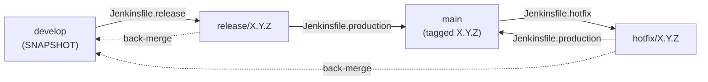
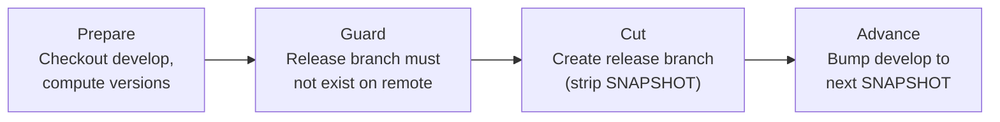
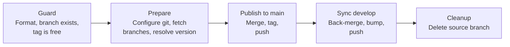
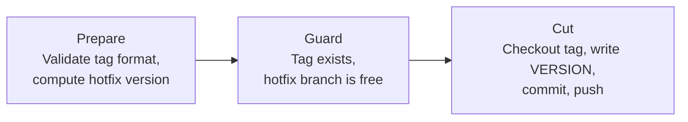
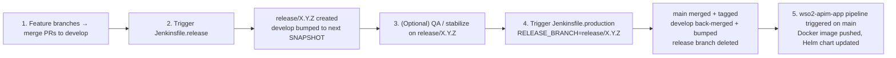
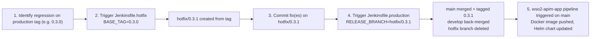

# ci-app-pipelines

**Jenkins pipelines automating the Gitflow release lifecycle of
[`wso2-apim-app`](link)**

Part of the [apim-gitops](hub-link) project. Handles branching, merging,
tagging, and cleanup so releases need no manual git operations.

---

## Table of Contents

- [Overview](#overview)
- [Pipelines](#pipelines)
  - [Jenkinsfile.release — Cut a Release](#jenkinsfilerelease)
  - [Jenkinsfile.production — Finalize a Release or Hotfix](#jenkinsfileproduction)
  - [Jenkinsfile.hotfix — Start a Hotfix](#jenkinsfilehotfix)
- [Workflows](#workflows)
- [Setup](#setup)
- [Safety Guards](#safety-guards)

---

## Overview

This repository contains three [Gitflow](https://github.com/apim-gitops#4-gitflow-branch-model--protection) Jenkins pipelines that automates the release lifecycle of `wso2-apim-app`. Every branch operation (create, merge,
tag, push, delete) is performed by Jenkins. 

**Pipeline workflow :**

---
## Pipelines

Each pipeline is a standalone, manually triggered Jenkins job. Internally they
run in **phases**; please refer to 
[Workflows](#workflows) ro see in which order trigger the pipelines.

| Pipeline | Input | Result |
|---|---|---|
| [`Jenkinsfile.release`](#jenkinsfilerelease) | none (optional bump settings) | `release/X.Y.Z` created, `develop` advanced |
| [`Jenkinsfile.production`](#jenkinsfileproduction) | `RELEASE_BRANCH` | Merged to `main`, tagged, `develop` synced |
| [`Jenkinsfile.hotfix`](#jenkinsfilehotfix) | `BASE_TAG` | `hotfix/X.Y.Z` created from a tag |
---

### Jenkinsfile.release

**Cuts a release.** Creates `release/X.Y.Z` from `develop` and advances
`develop` to the next `-SNAPSHOT`.

**Parameters**

| Parameter | Type | Default | Description |
|---|---|---|---|
| `AUTO_BUMP_MINOR` | Boolean | `true` | Bump `develop` to next MINOR (`X.(Y+1).0-SNAPSHOT`) |
| `NEXT_DEV_VERSION_OVERRIDE` | String | _(empty)_ | Explicit next dev version when auto-bump is off |

**Phases**

**Result**

| Branch | `VERSION` |
|---|---|
| `release/X.Y.Z` | `4.7.0+X.Y.Z` |
| `develop` | `4.7.0+X.(Y+1).0-SNAPSHOT` |

---

### Jenkinsfile.production

**Finalizes a release or hotfix.** Merges `release/X.Y.Z` or `hotfix/X.Y.Z`
into `main`, tags it, back-merges to `develop`, and deletes the source branch.

**Parameters**

| Parameter | Type | Default | Description |
|---|---|---|---|
| `RELEASE_BRANCH` | String | _(required)_ | e.g. `release/1.2.3` or `hotfix/1.2.4` |

**Phases**

| Phase | What it does |
|---|---|
| **Guard** | Regex check (`release/X.Y.Z` or `hotfix/X.Y.Z`, rejects `main`/`develop`), remote branch exists, tag does not exist yet |
| **Prepare** | Sets the Jenkins CI git identity, fetches `main`, `develop` and the source branch, reads `VERSION` (must not contain `-SNAPSHOT`) |
| **Publish to main** | `git merge --no-ff` with `[ci skip]`, annotated tag `X.Y.Z`, push `main` and the tag |
| **Sync develop** | `git merge --no-ff` back-merge, patch bump to `X.Y.(Z+1)-SNAPSHOT`, push `develop` |
| **Cleanup** | Deletes the source branch from the remote |

**Result**

| Branch / ref | State |
|---|---|
| `main` | `VERSION: 4.7.0+X.Y.Z`, tagged `X.Y.Z` |
| `develop` | `VERSION: 4.7.0+X.Y.(Z+1)-SNAPSHOT` |
| `release/X.Y.Z` or `hotfix/X.Y.Z` | deleted |

> The push to `main` is what triggers the
> [`wso2-apim-app` pipeline](https://github.com/apim-gitops/wso2-apim-app#ci-pipeline)
> (Docker build, push, Helm update).

---

### Jenkinsfile.hotfix

**Starts a hotfix.** Creates `hotfix/X.Y.Z` from an existing production tag.

**Parameters**

| Parameter | Type | Default | Description |
|---|---|---|---|
| `BASE_TAG` | String | _(required)_ | Production tag, e.g. `0.3.0` |
| `HOTFIX_VERSION_OVERRIDE` | String | _(empty)_ | Explicit version. Default: `BASE_TAG` patch + 1 |

**Phases**

**Result**

| Branch | `VERSION` |
|---|---|
| `hotfix/X.Y.Z` | `4.7.0+X.Y.Z` (branched from `BASE_TAG`) |

---

## Workflows

> These pipelines cover the **Gitflow release lifecycle** only. The Docker build,
> Docker Hub push, and Helm update are handled by the
> [`wso2-apim-app` pipeline](https://github.com/apim-gitops/wso2-apim-app#ci-pipeline),
> and the Kubernetes sync by ArgoCD. For the full end-to-end picture, see the
> [organization README](https://github.com/apim-gitops#architecture).

### Standard Release

**See also:** 
[Branching and releases](https://github.com/apim-gitops#branching-and-releases)
for the branch model, image tags per branch, and version format.

### Hotfix

**See also:** [Branching and releases](https://github.com/apim-gitops#branching-and-releases)
for how `hotfix/*` branches are versioned and tagged.

---

## Setup

These pipelines are plain Jenkinsfiles with no hardcoded job configuration.
To run them, create one Jenkins job per pipeline and provide the credentials below.

### Jenkins jobs

Each pipeline runs as a separate **Pipeline job** using *Pipeline script from SCM*
pointing at this repository.

| Job name | Script path | Purpose |
|---|---|---|
| `CRB` | `Jenkinsfile.release` | Cut a release branch |
| `FR` | `Jenkinsfile.production` | Finalize a release or hotfix |
| `HF` | `Jenkinsfile.hotfix` | Start a hotfix |

**Job configuration (same for all three):**

| Setting | Value |
|---|---|
| Definition | Pipeline script from SCM |
| SCM | Git, `https://github.com/gitops-apim/ci-app-pipelines.git` |
| Branch | `main` |
| Script Path | see table above |
| Triggers | None (manual only) |

> The pipelines check out the target repository (`wso2-apim-app`) themselves,
> so the job's own SCM only provides the Jenkinsfile.

### Credentials

Create these in Jenkins under *Manage Jenkins → Credentials*.

| Credential ID | Used in | Type |
|---|---|---|
| `wso2-apim-app-ci` | `Jenkinsfile.production` | GitHub App credential |
| `github-credentials` | `Jenkinsfile.release`, `Jenkinsfile.hotfix` | GitHub App or username/token |

### Required permissions

**GitHub (credentials above):**

| Permission | Scope | Why |
|---|---|---|
| Contents: read & write | `wso2-apim-app` | Push branches, tags and merge commits, delete branches |
| Metadata: read | `wso2-apim-app` | Required by GitHub Apps |

A Github app must be used and installed on `wso2-apim-app` only.

**Branch protection:** `main` and `develop` are protected. The identity used by
these credentials must be allowed to push to them, either by being added to the
bypass list or the push allowlist. Otherwise `Jenkinsfile.production` fails when
it pushes the merge to `main`.

**Jenkins:**

| Requirement | Why |
|---|---|
| Git installed on the agent | All pipelines run git commands directly |
| Agent with network access to GitHub | Fetch, push, `ls-remote` |
| Users allowed to run the three jobs | Jobs are manual; restrict them to release managers |

---

## Safety Guards

Every pipeline includes explicit runtime guards:

| Guard | Mechanism | Pipelines |
|---|---|---|
| **Branch name format** | Regex validation (`release/X.Y.Z`, `hotfix/X.Y.Z`) | All three |
| **Protected branch protection** | Explicit rejection of `main`/`develop` as targets | All three |
| **Remote existence check** | `git ls-remote` before checkout | All three |
| **Idempotency** | Tag and branch existence checks before creation | All three |
| **No concurrent runs** | `disableConcurrentBuilds()` | All three |
| **CI loop prevention** | `[ci skip]` / `[skip ci]` markers on automated commits | All three |
| **Workspace hygiene** | `cleanWs()` in `post` / `always` | All three |
